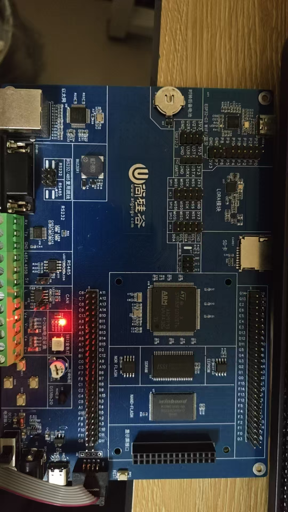

# mcu-learning

嵌入式 MCU 学习与项目日志 · 2026 年秋起，路线：C 语言 → 裸机外设 → FreeRTOS → 通信协议 → 完整项目。
两个项目目标：**环境监测终端**（采集/显示/上报）、**RTOS + Modbus + 串口 IAP 升级**。

## 目录

| 目录 | 内容 |
|---|---|
| `01-c/` | C 语言练习（指针、结构体、链表、位操作） |
| `02-stm32/` | 裸机外设练习（GPIO / 中断 / 串口 / 定时器 / ADC / I2C / SPI） |
| `03-rtos/` | FreeRTOS 练习（任务、队列、互斥、优先级反转） |
| `04-comm/` | Modbus RTU、RS485、IAP 升级 |
| `notes/` | 故障记录、每日日志、素材管理规范 |
| `_setup/` | 环境搭建证据（工具链截图、开发板引脚表） |

## 开发板

- **主控**：STM32F103ZET6（144 脚 / 512K Flash / 64K RAM）
- **LED**：PA0 / PA1 / PA8，低电平点亮（另有 PG11 电源指示灯）
- **按键**：PF8 / PF9（按下为高）、PF10 / PF11（按下为低）
- **串口**：USART1 = PA9(TX) / PA10(RX)，板载 CH340
- **SWD**：3V3 / GND / SWDIO(PA13) / SWCLK(PA14)
- **调试器**：ST-Link（含虚拟串口 COM4）

完整引脚对照见 [`_setup/README.md`](_setup/README.md)。

## 进度

- [x] 2026-10-29 基础工具链：VS Code / gcc / Git / hello world 跑通
- [x] 2026-10-29 GitHub 仓库建立，素材管理结构就位
- [x] 2026-11-01 上板工具链定版：Keil MDK-ARM 5.38a + CubeMX + ST-Link（不装 CubeIDE，Keil 已具备同等的编译与下载能力）
- [ ] 2026-10-29 串口工具 + PulseView 安装
- [x] 2026-10-30 C 语法速通（一）15 题（`01-c/w0-syntax/`）
- [x] 2026-10-31 C 语法速通（二）6 题：二分 / 冒泡 / 计算器 / strlen / strcpy / strcmp（`01-c/w0-func-str/`）
- [x] 2026-11-01 第一次上板点灯：STM32 走 SWD、51 走 ISP 冷启动，两块板各点一次（`02-stm32/2026-11-01-blink/`）
- [ ] 第 1 周 C 语言地基
- [ ] 第 2 周 上板外设
- [ ] 项目一 环境监测终端
- [ ] FreeRTOS + Modbus
- [ ] 项目二 + IAP 升级
