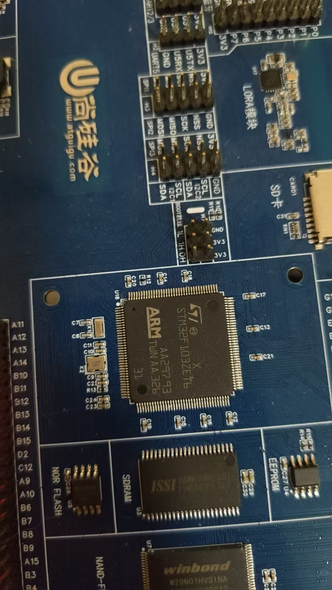

# mcu-learning

嵌入式 MCU 学习与项目日志。

## 目录

| 目录 | 内容 |
|---|---|
| `01-c/` | C 语言练习（指针、结构体、链表、位操作） |
| `02-stm32/` | 裸机外设练习（GPIO / 中断 / 串口 / 定时器 / ADC / I2C / SPI） |
| `03-rtos/` | FreeRTOS 练习（任务、队列、互斥、优先级反转） |
| `04-comm/` | Modbus RTU、RS485、IAP 升级 |
| `notes/` | 故障记录、知识点卡片、踩坑总结 |
| `_setup/` | 环境搭建截图 |

## 开发板

- 主控：STM32F103ZET6
- LED：PA0，PA1,PA8低电平亮
- 按键：KEY1 = PF8,KEY2 = PF9,KEY3 = PF10,KEY4 = PF11,
- 串口：USART1 = PA9 TX / PA10 RX，板载 CH340
- SWD：3V3 / GND / SWDIO(PA13) / SWCLK(PA14)
- 下载方式：ST-Link 

## 进度

- [x] 2026-10-29 基础工具链：VS Code / gcc / Git / hello world 跑通
- [x] 2026-10-29 GitHub 仓库建立，素材管理结构就位
- [ ] 2026-10-29 STM32CubeIDE 安装 + 空工程编译通过
- [ ] 2026-10-29 串口工具 + PulseView 安装
- [ ] 第 1 周 C 语言地基
- [ ] 第 2 周 上板外设
- [ ] 项目一 环境监测终端
- [ ] FreeRTOS + Modbus
- [ ] 项目二 + IAP 升级

